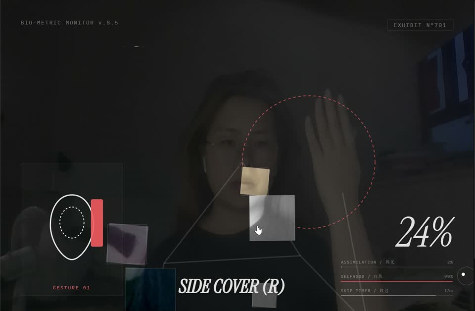

# Fit In / 合身

以身体姿态探索“服从、同化与自我”的浏览器互动作品。参与者根据扇语动作提示移动手部，也可以通过不完成动作保留拒绝的空间。

项目仓库：[Jingxuanhu0510/fit-in](https://github.com/Jingxuanhu0510/fit-in)

## 体验与解说

- [Hybrid 主程序](index.html)：鼠标演示 + 摄像头姿态互动，七组动作。
- [交互方法解说与实录](docs/demo.html)：中文操作步骤、原项目视频节选。
- [原 FINAL 版本](final.html)：保留八动作、身体和手部识别版本供对照。




[观看原项目演示片段](docs/original-demo.mp4) · 来自用户提供的《完整版本1.0.mp4》5–40 秒；历史录像不代表本次修复后的验收结果。

## 操作方法

**鼠标模式**：点击 Enter Simulation，移动鼠标控制当前手部，把手移至目标区域后停住。双手动作自动镜像另一只手。不需要键盘，原 README 中 A/D、W/S 等说明与该版本实现不符，已删除。

**摄像头模式**：点击 Enter With Body 并授权摄像头。让头、肩、双手完整入镜，自然站立完成校准。按屏幕指令完成右脸、左脸、遮面、封唇、心口、拂手和双手展示。位置、方向、主动移动与稳定性均会影响判定。摄像头模式需要 HTTPS 或 localhost，并能访问 MediaPipe 模型服务。

每轮 22 秒。稳定命中后累计保持进度，成功提高同化指标；超时记为抵抗。七轮结束比较同化与自我指标，输出 Absorbed 或 Unassimilated。摄像头丢失身体时暂停该轮计时。

## 本地运行

在项目目录执行：

```sh
python -m http.server 8000
```

打开 http://localhost:8000 。这是静态站点，无服务端、数据库或构建依赖。

## Render 部署

创建 Static Site，连接 GitHub 仓库，发布目录设为 `.`，无需构建。使用 Render 提供的 HTTPS 地址进入摄像头模式。部署配置以仓库内实际配置文件为准。

## 版本与修复

- 主入口来源：`fit-in-hybrid-body-interaction/index.html`。
- `final.html` 来源：`FIANL WORK CODING/coding/FIT IN FINAL.html`，与 ZIP 中目录结构对应。
- 修复 Hybrid 稳定速度计算中 `Math.max(..., 9)` 始终不小于 9、导致动作无法完成的问题。
- 修复严格模块中未声明 `alienation` 的赋值导致启动失败的问题。
- Node VM 执行真实脚本并模拟七组鼠标目标，已验证完成七轮并正常结束；真人摄像头识别尚未实测。

## 回归检查

```sh
node tests/interaction.cjs
```

## 技术与隐私

HTML、Canvas、原生 JavaScript、MediaPipe。摄像头推理在本地浏览器运行，当前页面没有上传或录制摄像头画面的代码；模型和库从外部服务加载。公开演示视频为用户提供素材的压缩节选。

## 文件

`index.html` 主互动；`final.html` 原版对照；`docs/demo.html` 中文演示解说；`docs/interaction-flow.svg` 流程图片；`docs/original-demo.mp4` 原项目实录节选。
