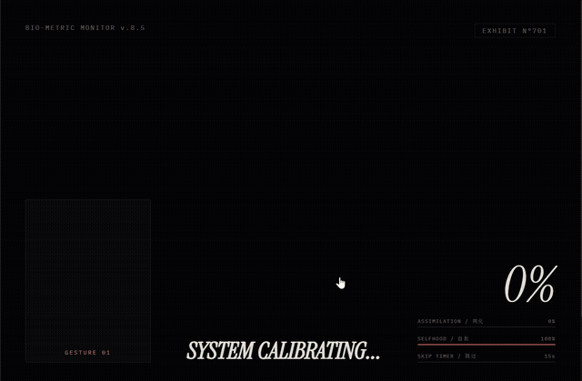
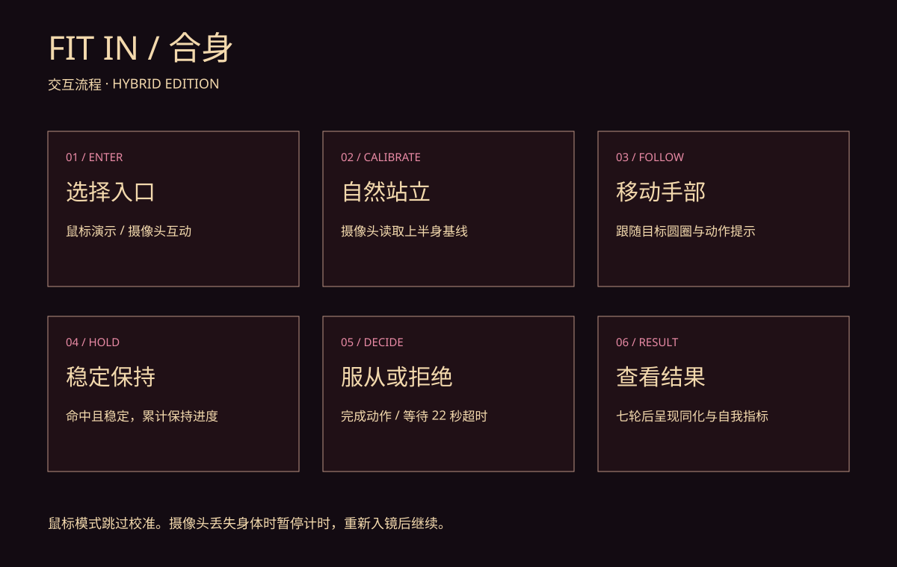

# Fit In / 迎合

通过摄像头、身体姿态与扇语动作，探索服从、同化与自我。

**[进入在线作品](https://fit-in-94sw.onrender.com/)**

本次发布唯一源码：用户指定目录 `coding/fit in/coding/FIT IN FINAL.html`，原样作为 `index.html` 部署。此版使用摄像头，包含八组动作。

## 交互演示

下面的动图直接在 README 中播放：参与者抬手靠近红色目标圈，命中后保持，右侧百分比增加，身体影像逐渐产生拼贴效果。



动图取自同一指定目录的《完整版本1.0.mp4》5–23 秒，为用户提供的历史实录，并非本次线上摄像头验收录像。

[查看更长的视频片段](docs/original-demo.mp4)

## 交互流程



1. 打开在线作品，等待识别模型加载，点击 **Initialize Census**。
2. 允许摄像头访问，让头、肩、手臂和双手完整入镜，等待 **System Calibrating…** 进度完成。
3. 看左侧动作图标与下方名称，将对应手部移到屏幕目标圈附近。
4. 命中后圈变绿，保持进度增加；偏离目标会使进度回落。双手动作需要两只手同时满足目标。
5. 保持达到 100% 或跳过计时耗尽，进入下一动作。完成八轮后显示结局；点击 **Restart** 重新开始。

## 八组动作怎么做

| 顺序 | 屏幕名称 | 操作说明 |
|---|---|---|
| 01 | SIDE COVER (R) | 右手靠近脸侧目标圈并保持。 |
| 02 | SIDE COVER (L) | 左手靠近另一侧脸部目标圈。 |
| 03 | MOUTH COVER (R) | 右手移到嘴部附近目标。 |
| 04 | MOUTH COVER (L) | 左手移到嘴部附近目标。 |
| 05 | T-POSE INTERSECT | 双手分别对准脸下方与侧边两个目标。 |
| 06 | BOTH VERTICAL SEAL | 双手靠近嘴部下方两个相邻目标。 |
| 07 | HEART PLEDGE | 右手靠近胸前目标。 |
| 08 | FINAL CROSS | 双手在胸前上方目标交叠，两手还需彼此接近。 |

画面为镜像，以屏幕目标圈和图标为准。同化（Assimilation）随命中增加，自我（Selfhood）随命中降低；未匹配时自我可恢复。

没有参与或同化值低于 8 时，结局为“你就是你自己”；其他情况下，四舍五入后的同化值高于 55 显示“判定合格”，否则“判定不合格”。这些是作品的艺术表达。

## 运行条件

需要摄像头、HTTPS（或 localhost）以及可加载 MediaPipe 库和模型的网络。建议使用桌面浏览器，光线均匀，保持上半身完整入镜。此版没有鼠标模拟或键盘动作控制。

界面跳过计时初值为 15，但原代码按动画帧递减；校准和保持进度也按帧累计，因此真实耗时受设备帧率影响。未检测到身体时不会推进动作计时。本次保留原版行为。

## 本地运行

```sh
python -m http.server 8000
```

浏览器打开 `http://localhost:8000`。Render 使用静态站部署，发布目录为 `.`，无需构建。

## 技术与验证

HTML / CSS / JavaScript / Canvas，MediaPipe PoseLandmarker 与 HandLandmarker。摄像头画面在浏览器内处理，源码没有上传摄像头视频的逻辑；库、模型和字体需要外部网络。

发布入口已与指定原文件核对 SHA-256，保持一致。历史 Hybrid 版的测试结果不适用于此版；真人摄像头识别仍需设备实测。
