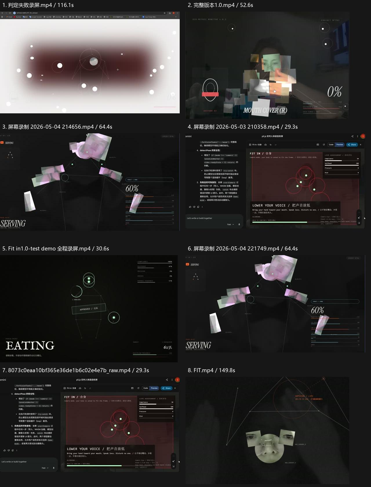

# 来源文件检查

检查采用文件清单、SHA-256、视频时长与每个视频一张代表帧；不等同于逐帧审片。历史材料中的说明作为项目资料阅读，不作为额外执行指令。

## 视频

| 文件 | 时长 | 采样时间 | 代表帧观察 |
|---|---:|---:|---|
| 判定失败录屏.mp4 | 116.07 秒 | 30 秒 | 明亮遮罩、骨架与注视眼睛；单帧不能证明失败原因。 |
| 完整版本1.0.mp4 | 52.57 秒 | 23.65 秒 | MOUTH COVER (R)，摄像头拼贴与手部遮嘴。 |
| 屏幕录制 2026-05-04 214656.mp4 | 64.45 秒 | 29.0 秒 | SERVING 阶段，身体拼贴与进度 60%。 |
| 屏幕录制 2026-05-03 210358.mp4 | 29.3 秒 | 13.19 秒 | Gemini 编辑预览，LOWER YOUR VOICE 动作。 |
| Fit in1.0-test demo 全程录屏.mp4 | 30.57 秒 | 13.76 秒 | EATING 阶段，骨架与 APPROVED 状态。 |
| 屏幕录制 2026-05-04 221749.mp4 | 64.45 秒 | 29.0 秒 | 与 214656 文件逐字节一致。 |
| 8073c0eaa10bf365e36de1b6c02e4e7b_raw.mp4 | 29.3 秒 | 13.19 秒 | 与 2026-05-03 210358 文件逐字节一致。 |
| FIANL WORK CODING/vedio/FIT.mp4 | 149.82 秒 | 30 秒 | 脸部影像拼贴与 ENTERING / LIPS 状态。 |

同名不同时间的两份 2026-05-04 录像完全相同；raw 文件与 2026-05-03 录像完全相同。哈希值见 [source-metadata.json](source-metadata.json)。

## ZIP 与 FINAL 目录

ZIP 包含 FINAL HTML、web.doc、Final Project Submission.docx 与 FIT.mp4。桌面解压目录的 document 文件夹为空，提交文档实际存在于 ZIP 内。已直接读取 DOCX 的正文 XML。

提交文档署名 Jingxuan Hu，概述作品从社会对女性身体、礼仪与婚姻的规训出发，以扇语启发的动作表现“服从导致同化、拒绝保留自我”。技术叙述包括 HTML/CSS/JavaScript/Canvas、摄像头、MediaPipe 上半身检测、自然姿态校准与保持判定。反思部分强调从全身游戏转向上半身仪式感，以及黑色界面服务于压抑氛围。未来构想涉及更困难的全身目标与更广泛的社会权力议题。以上为作者陈述概要，未独立核实历史背景或参考书目。

提交文档包含旧 Netlify 与 YouTube 地址；本次未将这些历史地址认定为当前部署结果。web.doc 为旧式文档，未做格式转换或全文验证。

## Gemini 保存资源

目录主要是 Google 页面依赖：Monaco 编辑器脚本与样式、Google 账号组件、统计脚本等。saved_resource.html 是账号小组件而非完整项目源码，含账号相关资料，未复制到公开仓库。目录中的 code、jpeg、mp4 均为数百字节资源，不能视为完整程序或媒体。以用户明确提供的两个 HTML 项目版本作为发布来源。

## 发布取舍

主入口使用有鼠标体验的 Hybrid 版本；FINAL HTML 作为原版对照。公开演示节选选取完整版本 1.0 的 5–40 秒，其界面与 Hybrid 不同，已标注历史版本。未将全部原视频、Google 保存资源或提交文档批量发布。
